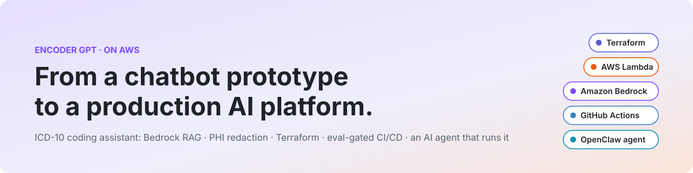
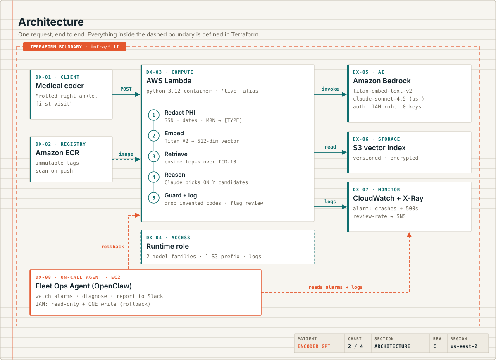
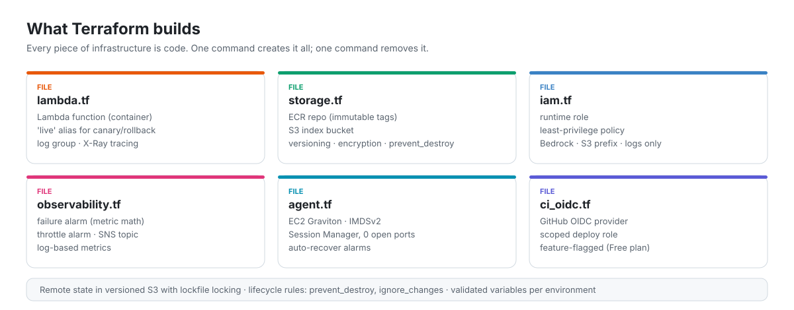
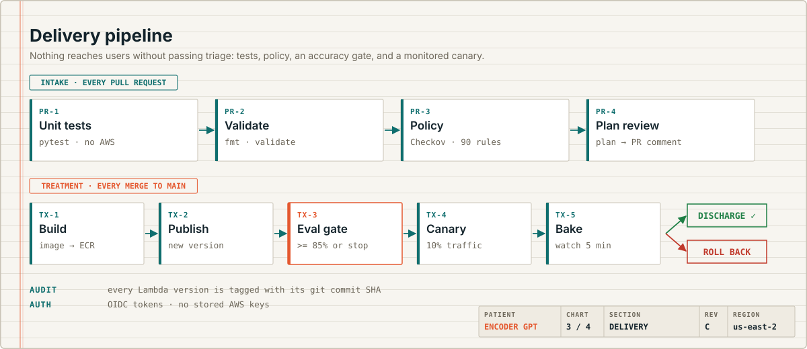

<picture>
  <source media="(prefers-color-scheme: dark)" srcset="docs/img/hero-dark.svg">
  
</picture>

**An ICD-10 coding assistant I first built as an OpenAI custom GPT, rebuilt as a production-style AI service on AWS, plus a persistent AI agent that operates it.**


| | |
|---|---|
| **The problem** | Medical coders lose time hunting for the right ICD-10 code, and mistakes affect claims. |
| **The prototype** | A custom GPT on OpenAI with RAG. It helped, but PHI safety was a policy ("don't type PHI"), accuracy was checked by hand, and nothing was monitored. |
| **This rebuild** | Bedrock RAG behind automatic PHI redaction, every piece of infrastructure in Terraform, a deploy pipeline that blocks changes failing an accuracy gate, and an on-call AI agent with a single permission to roll back. |

<picture>
  <source media="(prefers-color-scheme: dark)" srcset="docs/img/architecture-dark.svg">
  
</picture>

**Click a section to expand it.**

<details>
<summary><b>DX-01 · Amazon Bedrock: how the AI picks a code</b></summary>
<br>

Each request runs five steps inside Lambda:

1. **Redact PHI.** Identifiers are replaced with `[TYPE]` placeholders *before* any model sees the text. The backend is swappable via `redaction_mode`:
   - `comprehend`: Amazon Comprehend Medical, ML-based, catches names and free-text identifiers (AWS Paid plan)
   - `basic`: pattern matching for SSNs, phones, emails, dates, and MRN-style IDs. Runs at $0 on the Free plan, but **can miss untitled names and addresses: demo data only, never real PHI**
2. **Embed.** Titan Text Embeddings V2 turns the description into a 512-number vector that captures its meaning.
3. **Retrieve.** Cosine similarity finds the closest ICD-10 codes in the index (RAG: retrieval-augmented generation).
4. **Reason.** Claude on Bedrock chooses **only from the retrieved candidates**, with a confidence score and rationale.
5. **Guard.** Any code Claude returns that wasn't retrieved is dropped. Low confidence or no match sets `needs_human_review`.

**Why Bedrock:** models run inside the AWS account boundary, and access is granted by an IAM role, so there are **no API keys anywhere** in the code or config.

Suggestions are advisory. A certified coder makes the final call.

</details>

<details>
<summary><b>DX-03 · AWS Lambda: why serverless</b></summary>
<br>

- **Runs only when called.** No server to patch or pay for while idle; demo traffic costs pennies.
- **Container image** from ECR with immutable tags, so a version always means the same code.
- **Versions + a `live` alias** make canary releases and instant rollback possible: callers always hit `live`, and the pipeline moves it.
- **Structured logs** record latency, redaction types, and review flags, but never the input text.

**Lambda vs. EC2 in this repo:** the coding service is request-driven, so it's Lambda. The Fleet Ops Agent needs to stay connected and run on a schedule, so it's an always-on EC2 instance.

</details>

<details>
<summary><b>RX · Terraform: every resource is code</b></summary>
<br>

<picture>
  <source media="(prefers-color-scheme: dark)" srcset="docs/img/terraform-dark.svg">
  
</picture>

**Design decisions**
- **Remote state** in versioned, encrypted S3 with lockfile locking. Versioning means a corrupted or deleted state file can be restored instead of rebuilt with `terraform import`.
- **Partial backend config** (`backend.hcl`), because backend blocks can't read variables.
- **`ignore_changes = [image_uri]`** on the Lambda: Terraform owns the function's *shape*, CI/CD owns *which image* runs. Without it, every `terraform apply` would silently roll back the latest deploy.
- **`prevent_destroy`** on the index bucket protects the knowledge base.
- **Least-privilege IAM:** the runtime role can invoke two model families, read one S3 prefix, and write logs. Nothing else.
- **Feature flags** for components an account may not allow (GitHub OIDC, reserved concurrency, the agent).

**Policy exceptions:** Checkov runs on every PR. Skipped rules are deliberate trade-offs for a portfolio-scale service:

| Rule | Why skipped |
|---|---|
| Lambda in VPC (117) | Only calls AWS APIs; a VPC adds NAT cost with no security gain here. |
| Lambda DLQ (116) | Invoked synchronously; callers get errors directly. |
| Code signing (272), env var KMS (173) | Env vars hold no secrets; image integrity comes from immutable, scanned ECR tags. |
| Customer-managed KMS (158, 136, 145) | AWS-managed encryption is on; custom keys add cost without a compliance driver. |
| 1-year log retention (338) | 30 days for dev. Raise for prod per retention policy. |
| S3 replication, access logs, events, lifecycle (144, 18, 62, 61) | Reference data, rebuildable from the public CMS code set. |
| Wildcard on read-only APIs (356, agent only) | CloudWatch and Bedrock list APIs don't support resource scoping. Every write is scoped. |

</details>

<details>
<summary><b>TX · Delivery pipeline: trust built into the system</b></summary>
<br>

<picture>
  <source media="(prefers-color-scheme: dark)" srcset="docs/img/pipeline-dark.svg">
  
</picture>

**On every pull request** (`.github/workflows/ci.yml`): unit tests, `terraform fmt` and `validate`, Checkov policy checks, and `terraform plan` posted as a PR comment.

**On every merge** (`.github/workflows/deploy.yml`):
1. Build the container, tagged with the commit SHA
2. Publish a new Lambda version (the old one stays available)
3. **Eval gate:** run labeled cases against the new version *before* it gets traffic; below 85% accuracy, the deploy stops
4. **Canary:** route 10% of traffic to the new version
5. **Bake:** watch the failure alarm for 5 minutes
6. Healthy → promote to 100% and smoke-test through `live`; unhealthy → **automatic rollback**

</details>

<details>
<summary><b>DX-08 · Fleet Ops Agent: an AI that operates the service</b></summary>
<br>

A persistent [OpenClaw](https://docs.openclaw.ai) agent on EC2 that acts like a junior on-call engineer:

- **Watches** alarms on a schedule and posts a morning digest to Slack
- **Diagnoses** failures by following [`RUNBOOK.md`](RUNBOOK.md) layer by layer
- **Rolls back** a bad deploy, only when the rules allow it, then verifies with evals
- **Escalates** problems rollback can't fix (IAM, model access, missing index) with the exact human fix

**The safety model:** the agent's instructions say what it *should* do; IAM decides what it *can* do. It has read-only access plus **one** write permission, moving the `live` alias, and an explicit deny blocks code, IAM, and S3 changes. No SSH, no open ports, no stored AWS keys.

Full design and setup: [`agent/README.md`](agent/README.md). `scripts/chaos.sh` simulates a bad deploy for a live demo.

</details>

<details>
<summary><b>Case notes · Real problems I solved while deploying</b></summary>
<br>

| Symptom | Diagnosis | Fix |
|---|---|---|
| S3 bucket creation denied | The error named an **explicit deny in a service control policy**: an org-level guardrail that overrides account permissions. Tested the same call in another region, and it succeeded, so the account was **locked to its home region**. | Region became a variable (default `us-east-2`) instead of hardcoded. |
| GitHub OIDC provider denied | Same guardrail blocks creating identity providers on this account type. | Made OIDC an optional feature flag so the core service still deploys. |
| Lambda rejected reserved concurrency | New accounts get 10 concurrent executions, and AWS requires all 10 to stay unreserved. | Made it configurable, defaulting to unreserved, with the reason documented. |
| Alarm would never fire on failures | The app catches exceptions and returns HTTP 500, so Lambda's built-in `Errors` metric stays at zero. | Added a log-based failure metric and combined both with alarm metric math. |

The last one was caught by reasoning about *how the code fails*, before it caused a missed incident.

</details>

<details>
<summary><b>Vitals · Accuracy, PHI, and drift</b></summary>
<br>

| | Prototype (custom GPT) | This rebuild |
|---|---|---|
| PHI protection | Policy: "don't enter PHI" | Automatic redaction before the model, swappable backend |
| Credentials | Platform login | IAM roles, no API keys |
| Invented codes | Possible | Restricted to retrieved candidates, then filtered |
| Accuracy checks | Manual spot-checks | Automated eval suite gating every deploy |
| Monitoring | None | Alarms, X-Ray traces, human-review-rate metric |
| Infrastructure | Clicked together | Terraform, version-controlled, reviewable |

**Handling drift:** ICD-10-CM changes every October 1st. The code set, index, prompt, and model are each versioned, and none changes without passing evals and a canary. In production, a rising human-review rate or coder-override rate signals drift that evals missed.

</details>

<details>
<summary><b>Deploy it yourself</b></summary>
<br>

Prereqs: an AWS account, Terraform ≥ 1.10, Docker, and Bedrock access to Claude and Titan Embeddings in your region.

```bash
# 1. State bucket (once): a versioned, private S3 bucket in your region, then:
cp infra/backend.hcl.example infra/backend.hcl          # fill in the bucket name
cp infra/terraform.tfvars.example infra/terraform.tfvars # fill in github_repo

# 2. Bootstrap: registry first, then push an image so Lambda has something to run
cd infra && terraform init -backend-config=backend.hcl
terraform apply -target=aws_ecr_repository.app
REPO=$(terraform output -raw ecr_repository_url)
aws ecr get-login-password | docker login --username AWS --password-stdin "${REPO%%/*}"
docker build --platform linux/amd64 --provenance=false -t "$REPO:bootstrap" ../app && docker push "$REPO:bootstrap"

# 3. Everything else
terraform apply

# 4. Build the retrieval index
cd .. && python scripts/build_index.py --bucket "$(terraform -chdir=infra output -raw index_bucket)"

# 5. Try it
aws lambda invoke --function-name encoder-gpt-dev --qualifier live \
  --cli-binary-format raw-in-base64-out \
  --payload '{"description":"Rolled right ankle playing basketball, ligament sprain, first visit"}' out.json && cat out.json
```

**On an AWS Free plan account,** AWS-managed guardrails apply. The defaults handle them: `region` set to your home region, `enable_github_oidc = false` (deploy from CloudShell), and `lambda_reserved_concurrency = -1`.

**With a Paid plan,** set `enable_github_oidc = true` and the GitHub repo variables `AWS_CI_ROLE_ARN`, `AWS_REGION`, `ENVIRONMENT`, and `TF_BACKEND_HCL` to turn on the automated pipeline.

**Cost:** pennies at demo volume. Run `terraform destroy` when done (remove `prevent_destroy` first).

</details>

<details>
<summary><b>Repo layout</b></summary>
<br>

```
app/        Lambda container: handler, PHI redaction, retrieval
agent/      Fleet Ops Agent: OpenClaw skill, config, setup
data/       ICD-10-CM sample (public CMS code set)
evals/      Labeled cases + eval runner used as the deploy gate
infra/      Terraform: ECR, Lambda, IAM, S3, CloudWatch, OIDC, agent EC2
scripts/    Index builder and chaos.sh (simulated bad deploy)
tests/      Unit tests (no AWS needed)
.github/    CI (PR checks) and Deploy (canary + rollback) workflows
RUNBOOK.md  How to diagnose failures layer by layer
```

</details>

### Next up
- Index the full ICD-10-CM code set (~74,000 codes) with in-memory vector search, hybrid keyword matching, and code-set versioning
- Grow the eval set across every ICD-10 chapter and track accuracy over time
- A small coder UI with thumbs-up/down feedback that feeds the eval set
