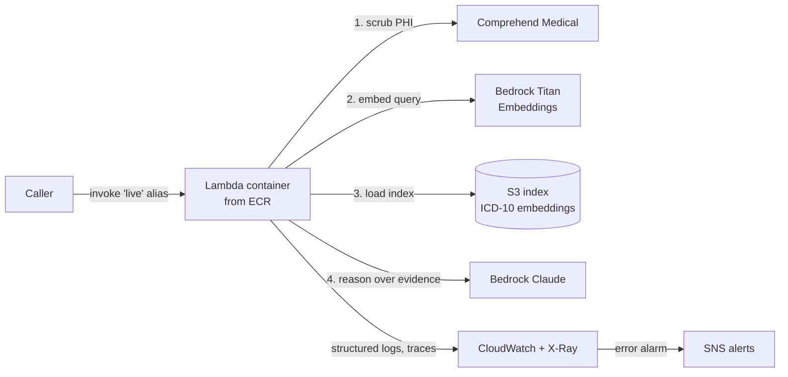

# Encoder GPT on AWS

**An ICD-10 coding assistant, rebuilt from a prototype into a production-grade AI service on AWS.**

The original Encoder GPT was a custom GPT I built on OpenAI with RAG to help coders find accurate ICD-10 codes in a healthcare setting. It worked, but it had the gaps prototypes usually have: PHI protection depended on users following a policy, accuracy was checked by hand, and there was no deployment process, rollback, or monitoring.

This repo is the platform version: same job, rebuilt on AWS with Bedrock, Terraform, containers, and a CI/CD pipeline that won't ship a model change unless it passes an accuracy gate.

> **Status:** reference implementation. Unit tests pass and the Terraform passes `fmt` and Checkov policy checks. *(Update this line once deployed to a sandbox account.)*

---

## Architecture



**Request flow**
1. **Redact:** Comprehend Medical detects names, dates, MRNs, and other PHI and replaces them with `[TYPE]` placeholders *before* anything reaches a model.
2. **Retrieve:** the description is embedded with Titan and matched against ICD-10 reference entries by cosine similarity.
3. **Reason:** Claude on Bedrock picks codes **only from the retrieved candidates**, returning confidence and a rationale.
4. **Guard:** any code the model returns that wasn't retrieved is dropped. Low confidence or no match sets `needs_human_review`.
5. **Observe:** structured logs (never the input text), X-Ray traces, and alarms.

Suggestions are advisory. A certified coder makes the final call.

---

## Prototype vs. platform

| | Original (custom GPT) | This rebuild |
|---|---|---|
| PHI protection | Policy: "don't enter PHI" | Technical control: automatic redaction before the model |
| Model access | OpenAI, consumer tier | Bedrock, inside the AWS account boundary |
| Credentials | Platform login | IAM role, **no API keys anywhere** |
| Hallucinated codes | Possible | Model restricted to retrieved candidates, post-filtered |
| Accuracy checks | Manual spot-checks | Automated eval suite gating every deploy |
| Deploys | Edit prompt in UI | PR → tests → policy checks → plan → canary → promote/rollback |
| Monitoring | None | CloudWatch alarms, X-Ray, human-review-rate metric |
| Infrastructure | Clicked together | Terraform, version-controlled, reviewable |

---

## Delivery pipeline

**On every PR** (`.github/workflows/ci.yml`)
- Unit tests (redaction and retrieval logic, no AWS calls)
- `terraform fmt -check` and `terraform validate`
- **Checkov policy checks:** blocks things like public buckets or unencrypted resources
- `terraform plan` posted as a PR comment so a human reviews the exact infra change

**On merge to main** (`.github/workflows/deploy.yml`)
1. Build the container, tagged with the commit SHA (ECR tags are immutable)
2. Publish a new Lambda version (the old one stays available)
3. **Eval gate:** run labeled cases against the *new version* before it gets any traffic. Below 85% top-1 accuracy, the deploy stops.
4. **Canary:** route 10% of `live` traffic to the new version
5. **Bake:** watch the error alarm for 5 minutes
6. Healthy → promote to 100% and run a production smoke test through `live`
7. Unhealthy or any failure → **automatic rollback** to the previous version
8. **Audit trail:** every version's description is its commit SHA, and the workflow log records who deployed what

AWS access uses **GitHub OIDC**: short-lived tokens, no stored AWS keys.

---

## Terraform design decisions

- **Remote state** in versioned, encrypted S3 with native lockfile locking. Versioning means a corrupted or deleted state file can be restored instead of rebuilt with `terraform import`.
- **Partial backend config** (`backend.hcl`), because backend blocks can't read variables.
- **`lifecycle { ignore_changes = [image_uri] }`** on the Lambda: Terraform owns the function's *shape*, CI/CD owns *which image* runs. Without it, every `terraform apply` would silently roll back the latest deploy.
- **`prevent_destroy`** on the index bucket protects the knowledge base.
- **Least-privilege IAM:** the runtime role can invoke specific Bedrock model families, read one S3 prefix, and call `DetectPHI`. Nothing else.
- **Environments** via `var.environment` (validated to dev/staging/prod) with separate state keys per environment.
- **Reserved concurrency** caps Bedrock spend if a client misbehaves.

### Policy exceptions
Skipped Checkov rules, each a deliberate trade-off for a portfolio-scale service:

| Rule | Why skipped |
|---|---|
| Lambda in VPC (117) | Only calls AWS APIs; a VPC adds NAT cost with no security gain here. Required if it ever touched private data stores. |
| Lambda DLQ (116) | Invoked synchronously; callers get errors directly. |
| Code signing (272), env var KMS (173) | Env vars hold no secrets; image integrity comes from immutable, scanned ECR tags. |
| KMS for logs/ECR/S3 (158, 136, 145) | AWS-managed encryption is on; customer-managed KMS keys add cost without a compliance driver. |
| 1-year log retention (338) | 30 days for dev. Raise for prod per retention policy. |
| S3 replication, access logs, events, lifecycle (144, 18, 62, 61) | Reference data, rebuildable from the CMS code set. |

---

## Deploy it yourself

Prereqs: AWS account, Terraform ≥ 1.10, Docker, and **Bedrock model access enabled** for Claude and Titan Embeddings in your region.

```bash
# 1. State bucket (once): create a versioned, encrypted S3 bucket, then
cp infra/backend.hcl.example infra/backend.hcl          # fill in bucket name
cp infra/terraform.tfvars.example infra/terraform.tfvars # fill in github_repo

# 2. Bootstrap: registry first, then push an image so Lambda has something to run
cd infra && terraform init -backend-config=backend.hcl
terraform apply -target=aws_ecr_repository.app
REPO=$(terraform output -raw ecr_repository_url)
aws ecr get-login-password | docker login --username AWS --password-stdin "${REPO%%/*}"
docker build --platform linux/amd64 --provenance=false -t "$REPO:bootstrap" ../app && docker push "$REPO:bootstrap"

# 3. Everything else
terraform apply

# 4. Build the retrieval index
cd .. && python scripts/build_index.py --bucket "$(terraform -chdir=infra output -raw index_bucket)"

# 5. Try it
aws lambda invoke --function-name encoder-gpt-dev --qualifier live \
  --cli-binary-format raw-in-base64-out \
  --payload '{"description":"Rolled right ankle playing basketball, ligament sprain, first visit"}' out.json && cat out.json
```

Then set GitHub repo variables `AWS_CI_ROLE_ARN`, `AWS_REGION`, `ENVIRONMENT`, and `TF_BACKEND_HCL`.

**Cost:** pennies per day at demo volume. Lambda, S3, and CloudWatch fall in the free tier; you pay per Bedrock and Comprehend Medical call. Run `terraform destroy` when done (remove `prevent_destroy` first).

---

## Repo layout

```
app/        Lambda container: handler, PHI redaction, retrieval
data/       ICD-10-CM sample (public CMS code set)
scripts/    Index builder (re-run each October when CMS updates codes)
evals/      Labeled cases + eval runner used as the deploy gate
tests/      Unit tests (no AWS needed)
infra/      Terraform: ECR, Lambda, IAM, S3, CloudWatch, GitHub OIDC
.github/    CI (PR checks) and Deploy (canary + rollback) workflows
RUNBOOK.md  How to diagnose failures layer by layer
```

## What I'd add next
- Bedrock Knowledge Bases or OpenSearch Serverless once the corpus grows past the sample
- Larger eval set built from real (de-identified) coder decisions, tracking accuracy over time
- Full ICD-10-CM code set and coding guideline documents in the index
- A small UI for coders, with a thumbs-up/down that feeds the eval set
