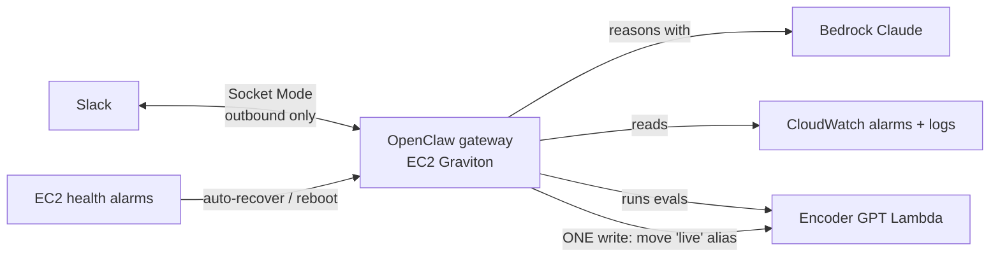

# Fleet Ops Agent

A persistent [OpenClaw](https://docs.openclaw.ai) agent that runs 24/7 on AWS and **operates Encoder GPT**: it watches alarms, diagnoses failures with the runbook, rolls back bad deploys, and reports in Slack.



## Design decisions

| Concern | Decision |
|---|---|
| **Access boundary** | The skill says what the agent *should* do; IAM decides what it *can* do. Read-only everywhere, plus one write (`lambda:UpdateAlias` on `live`). An explicit Deny blocks code changes, IAM, and S3 writes even if the role is widened later. Prompt injection can't grant permissions the role doesn't have. |
| **Credentials** | No AWS keys anywhere: Bedrock and AWS APIs use the instance role. Slack tokens live in SSM Parameter Store (SecureString) and reach the gateway as environment variables at runtime, never in config files or git. |
| **Network** | Zero inbound ports. Slack uses Socket Mode (outbound connection), and admin access is Session Manager, so there are no SSH keys. A public IP provides outbound internet without a $32/month NAT gateway. |
| **Recovery** | EC2 auto-recovers on host failure and reboots on instance failure; the gateway is a systemd service that restarts on crash. |
| **Judgment** | Rollback rules are explicit: only for a *recent deploy* while the failure alarm is firing. For IAM, model access, or index problems, rollback won't help, so the agent reports the human fix instead. |
| **Cost** | Off by default. t4g.small ≈ $12/month of credits while running. Stop the instance between demos. |

## Setup

**Prereqs:** Encoder GPT deployed (see the main README) and Bedrock working in your account.

### 1. Create a Slack app (5 min)
1. [api.slack.com/apps](https://api.slack.com/apps/new) → **Create New App** → **From a manifest** → pick your workspace → paste the manifest from [OpenClaw's Slack setup page](https://docs.openclaw.ai/channels/slack/setup) (Minimal is fine).
2. **Basic Information → App-Level Tokens → Generate**, add scope `connections:write` → copy the `xapp-…` token.
3. **Install App → Install to Workspace** → copy the `xoxb-…` bot token.
4. Create a channel such as `#fleet-ops`, invite the bot, and copy the channel ID (channel name → *About* → bottom of the panel).

### 2. Store the secrets (CloudShell)
```bash
P=/encoder-gpt/dev/agent
aws ssm put-parameter --name $P/slack-bot-token  --type SecureString --value 'xoxb-...'
aws ssm put-parameter --name $P/slack-app-token  --type SecureString --value 'xapp-...'
aws ssm put-parameter --name $P/slack-channel-id --type String       --value 'C0123456789'
```

### 3. Turn the agent on
In `infra/terraform.tfvars` set `enable_fleet_agent = true`, then:
```bash
cd infra && terraform apply
```
Wait about 5 minutes for the boot script to install Node and OpenClaw.

### 4. Connect and finish setup
```bash
$(terraform output -raw agent_connect_command)   # opens a shell on the agent
sudo -iu ec2-user
tail -3 /var/log/fleet-agent-bootstrap.log        # should say BOOTSTRAP COMPLETE
openclaw onboard --install-daemon                 # interactive; skip model/channel steps, setup.sh handles them
~/encoder-gpt/agent/setup.sh
```

### 5. Test it
```bash
openclaw agent --message "Use the fleet-ops skill to run a health check on Encoder GPT."
```
Then in Slack, mention the bot: *"Is Encoder GPT healthy?"*

### 6. The demo: catch a bad deploy
From CloudShell (your credentials, not the agent's):
```bash
scripts/chaos.sh dev
```
This puts a deliberately broken version live. Within a couple of minutes the alarm fires; ask the agent to investigate, and watch it find the bad version, roll back, verify with evals, and report. **Record this.**

## Stop / start to save credits
```bash
aws ec2 stop-instances  --instance-ids $(terraform -chdir=infra output -raw agent_instance_id)
aws ec2 start-instances --instance-ids $(terraform -chdir=infra output -raw agent_instance_id)
```

## Notes
- OpenClaw evolves quickly. If a CLI flag in `setup.sh` has changed, check `openclaw <command> --help` and the [docs](https://docs.openclaw.ai).
- Scheduled checks run every 2 hours on weekdays (8am–6pm Central), plus a digest at 8:31am. Edit with `openclaw cron list`.
